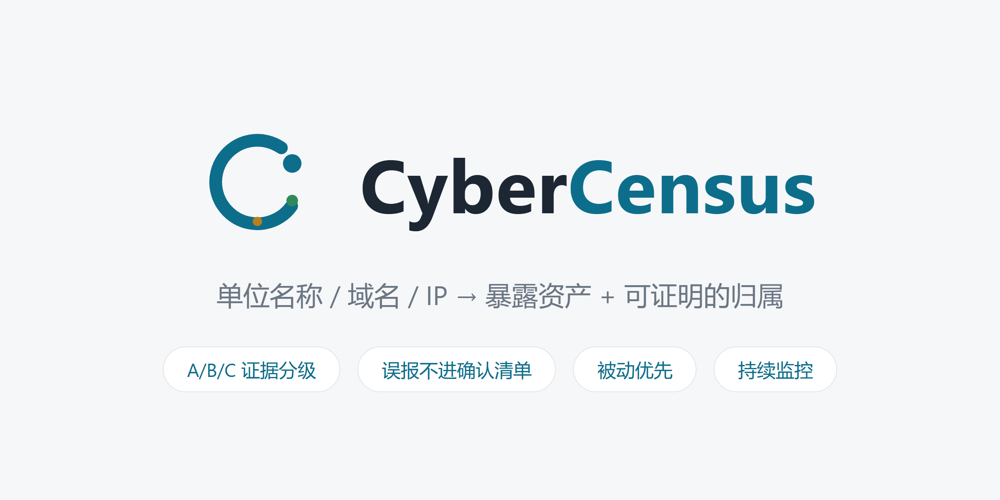

<p align="center"></p>

# CyberCensus —— 单位名称 / 域名 / IP 的互联网暴露面测绘工具

<p align="center"><b>Find every exposed asset. Prove every attribution.</b><br>
不猜、不堆数量：每一条资产都要有证据。</p>

[](LICENSE)
[](https://www.python.org/)
[](#)
[](CHANGELOG.md)

<p align="center"></p>

**English:** [README.en.md](README.en.md) · **开源核心/商业服务边界:** [COMMERCIAL.md](COMMERCIAL.md)

> 给一个**单位名称、域名或 IP**，自动找出该单位暴露在公网上的资产，并按证据强度分成 **确认 / 疑似 / 剔除** 三份台账——**误报不进确认清单**。

### 三个真正的亮点

1. **证据优先，不是"搜到就算"**：每条资产都标注 A/B/C 证据——ICP 备案号主号、证书 `O=`、统一社会信用代码、RDAP 注册人、自有 ASN、统计/像素 ID、验证令牌、联系方式、互链；**A≥1 或 B≥2 才进"确认"**，剔除项写明原因，可人工复核改判。
2. **只给单位名称也能开工**：搜索引擎官网自举 → 标题/证书互证 → crt.sh 子域 → DNS/whois/IP 反查；**不配任何平台 Key 也能跑**。统计 ID、验证令牌、证书 SAN 兄弟域、MX/SPF 还能继续扩展出"域名不像、也没有备案"的关联站点。
3. **从发现到交付是一条链**：8 个测绘平台可选联动、持续监控 + 基线对比、资产关系图谱、人工复核、7 种报告格式；Windows 解压双击即用，完整包自带 subfinder/httpx/wafw00f/nuclei 和官方模板。

> ⚠️ **仅限自有资产或已获书面授权的目标使用。** 默认被动；主动扫描会真实访问目标，请先确认授权。详见 [SECURITY.md](SECURITY.md) 与文末「注意事项」。

**解决什么问题**：政府、医院、学校、企业往往不清楚自己在互联网上开放了多少系统（官网、挂号系统、OA、测试环境……）。本工具从单位名称出发，聚合多平台数据源 + 本地被动采集，把"属于这家单位的公网资产"梳理成一份能直接交付的台账。

- 接入 **FOFA、零零信安（0.zone）、鹰图（Hunter）、DayDayMap、ZoomEye（知道创宇）、360 Quake、Shodan、Censys** 八个网络空间测绘平台（可选，**不配 Key 也能用**）
- 无 Key 时的本地底座：**搜索引擎官网自举**（找官网 → 标题/证书互证）→ crt.sh 子域名 → DNS / whois / IP 反查
- 多平台结果**聚合、去重、交叉印证**
- 报告自带**新手导读**和每条资产的**白话归属说明**（"该站备案号与目标单位一致"），不懂技术也能看懂哪些资产是哪家的
- 默认**被动**（第三方数据），主动扫描必须显式开启并确认授权

## 三步上手（不需要任何技术背景）

### 方式一：下载免安装包（推荐，真正解压即用）

**Windows：**

1. 到本仓库的 **Releases** 页面，下载 **`CyberCensus-win64.zip`**（64 位，约 138MB）
2. 解压到任意目录，**双击 `CyberCensus.exe`** 打开软件窗口
3. 在目标框输入单位名称（如"某某市人民医院"），点 **▶ 开始测绘**；跑完看三张结果卡片，点 **查看报告**——报告开头就有"怎么读这份报告"，每条资产都写明白了"为什么算它的"

免安装包已经带齐：

| 内容 | 作用 |
|---|---|
| `CyberCensus.exe` | 主程序（单文件，无需 Python） |
| `tools\subfinder.exe` | 被动子域名枚举 |
| `tools\httpx.exe` | 存活探测 / Web 指纹 |
| `tools\wafw00f.exe` | WAF 识别（已冻结为独立 exe，无需 Python） |
| `tools\nuclei.exe` | 模板化漏洞验证 |
| `nuclei-templates\` | nuclei 官方模板，开箱即用 |

程序会按 `PATH → exe 同级 tools\ → bin\` 的顺序自动发现这些工具，**不需要配置环境变量**。

> 也可以只下载 **`CyberCensus.exe`**（约 37MB）：主程序照常运行，只是 subfinder/httpx/wafw00f/nuclei 这四项增强会自动跳过（日志会写"未检测到…"），不影响被动采集、证据分级和报告。
> ⚠️ SmartScreen 可能提示"未知发布者"（未购买代码签名证书的通病），点"仍要运行"即可。

**32 位 Windows（x86）：**

- 下载 **`CyberCensus-win32.zip`**（32 位 exe + 32 位增强引擎）
- 查看系统类型：设置 → 系统 → 关于 → “系统类型”；显示“32 位操作系统”就用 win32 包
- 适用范围：Windows 8.1 / 10 / 11 的 32 位版本；Windows 7 及更早系统不受 Python 3.11 支持，无法运行官方包
- 64 位系统请优先用 `CyberCensus-win64.zip`，不要混用两个包里的 exe

**Linux（x86_64，命令行）：**

1. 下载 **`CyberCensus-linux-x86_64.tar.gz`**
2. 解压后进入目录，首次运行 `./install.sh`（创建 `.venv` 并安装 dnspython / cryptography / pypinyin）
3. 之后直接跑：

```bash
./cybercensus -n "单位名称"
./cybercensus -d example.com
```

包内自带 Linux 版 `subfinder` / `httpx` / `nuclei` 和 `nuclei-templates/`，不需要配 PATH；`wafw00f` 可选安装（`pip install wafw00f`）。

> Linux 包只含命令行。需要图形界面时，在带桌面环境的 Linux 上从源码运行：
> `pip3 install customtkinter && python3 asm_gui.pyw`（部分发行版需先装 `python3-tk`）。

### 方式二：从源码运行（需要 Python 3.8+）

1. **双击 `启动界面.bat`**（或 `run.bat`）—— 首次会自动装好界面依赖并打开软件窗口
2. 输入目标开始测绘（同上）

> 两种方式功能完全一致。域名、IP、网段也行，混着填都可以。

### 给自己打包 exe（可选）

```bat
pip install customtkinter dnspython cryptography pypinyin pyinstaller
pyinstaller --onefile --windowed --name CyberCensus --collect-all customtkinter --collect-all pypinyin asm_gui.pyw
:: 产物在 dist\CyberCensus.exe；推送 v* 标签时 GitHub Actions 也会自动构建发布
```

> 平台 Key（FOFA 等）是可选增强：左侧栏点"配置平台 Key…"填入即可，填了查得更全；不填则走本地被动采集，同样能出结果。

## ⚠️ 合规提醒

本工具仅限**对自有资产或已获书面授权的目标**使用。默认被动模式只查询第三方数据源；主动扫描会真实访问目标，请务必确认授权后再开启。详见[注意事项](#注意事项务必阅读)。

配套方法论文档：`docs\单位名称暴露面全量测绘方法.md`、`docs\互联网暴露面梳理工作方法.md`

---

## 图形界面（推荐，双击即用）

不想记命令行参数，直接用界面——**深空黑 + 青色霓虹的科技风**，左侧栏 + 主工作区布局：

```
双击 启动界面.bat      （首次会自动安装界面依赖 customtkinter，之后秒开）
双击 run.bat           （不带参数时同样直接打开界面；带参数则是命令行模式）
```

- 目标框里填 **单位名称 / 域名 / IP / 网段**（可多个，空格或逗号分隔），输入时实时显示识别结果
- **四种模式做成选择卡片**（纯被动 / 标准 / 复核 / 主动），每张卡直接标出该模式会用到哪些能力；选中后顶部代号、主按钮、进度条、标签页同步换色（青→蓝→黄→红），主动模式还要求勾选书面授权
- 卡片下方是**能力矩阵**：被动源 / subfinder / httpx / wafw00f / 端口扫描 / nuclei 逐项亮灭，一眼看出当前模式跑什么
- 左侧栏"增强引擎"实时显示四个引擎的 READY / MISSING 状态（免安装包里的 `tools\` 会被自动识别）；下方 **「⟳ 检查 / 更新增强引擎」** 可对比官方最新版并一键升级（下载 → 版本校验 → 备份 → 原子替换，失败自动回滚），同时可更新 nuclei 模板；平台开关按已配置的 Key 自动启用
- 运行时**进度条显示百分比 + 当前阶段 + 预计剩余时间**：进入长阶段后按"最近 90 秒实际进度速率"估算，取最近几次的中位数并平滑，避免早期或阶段切换时数字乱跳；超过 40 秒没有新进度会提示"当前阶段较慢…"而不是继续瞎猜
- **扫描不自动写报告**：完成后结果直接进"资产列表"表格（分类/主机/IP/端口/标题/白话归属说明，按确认→疑似→存疑着色排序），先在界面里看
- **结果卡片可点击筛选**：点「确认资产 / 疑似资产 / 剔除（存疑）」只看该类；**再点同一个卡片恢复全部**。剔除清单也会显示每一行的具体剔除原因，不会只给一个数字
- **人工复核**：双击任意资产行打开详情（备案/证书/RDAP/ASN/联系方式/全部证据/剔除原因），可手动改判为 确认 / 疑似 / 存疑；改判立即反映到表格、卡片计数和随后导出的报告（扫描重跑会重新自动分级）
- **多选与批量操作**：表格第一列是复选框，点表头下方「☐ 全选」可选中当前列表（受卡片筛选/搜索框影响），也可 Ctrl+A；选中后可**批量标记确认/疑似/存疑**，不用再一个个点详情
- **定时巡航面板**：表格上方「定时巡航」标签页可载入 tasks.json，查看每个任务的下次运行时间与状态，一键**启动/停止后台巡航**、**立即执行一次**；点「+ 当前目标」会把当前目标、模式、输出目录、范围文件、保留轮数自动写成一条任务，不用手写 JSON
- **资产范围与保留**：高级参数里可选择范围文件、勾选「只看范围内/相似资产」、设置「报告保留 N 轮」，全部在界面完成
- **端口预设与字典**：高级参数可选择 top 100 / 1000 / 10000、自定义端口或上传端口字典文件；全端口扫描仍保留
- **首次启动条款确认**：第一次打开会要求确认“仅限自有或已获书面授权的目标 + 已阅读 TERMS”，同意后才能扫描；左侧「关于 / 使用条款」可随时查看版本、许可证和条款
- **报告页脚**：导出的 HTML/PDF/Word/TXT/Markdown 报告自动带授权声明、项目链接和版本号
- **复制与导出**：选中后「复制URL」/「复制主机」直接进剪贴板，方便粘贴到浏览器或扫描器；「导出选中CSV」保存主机、IP、端口、URL、归属说明与完整证据
- **搜索与排序**：表头上方搜索框按主机/IP/标题实时过滤；点击任意表头按该列升序/降序排序（带 ▲▼ 指示）
- **右键菜单**：表格行右键可直接查看详情、批量改判、复制 URL/主机；Ctrl+C 复制选中 URL
- 满意后再点 **⬇ 生成报告…** 按需选择导出格式（网页 HTML / PDF / Word DOCX / 纯文本 TXT / Markdown MD / 资产台账 CSV / 原始数据 JSON），对话框内每种格式都有一句话用途说明；保存位置可改
- "高级参数"是独立设置窗口（并发/端口/输出目录/敏感路径/外部工具/Webhook），不再挤占结果区
- 「高级参数 → APP/小程序包」可导入本机 APK / `.wxapkg`（文件或目录），本地静态提取包内硬编码后台域名与接口地址；扫描即使 0 资产，只要 APP/包/密钥有结果也能生成报告

打包成单个 exe（可选）：

```bat
pip install pyinstaller
pyinstaller --onefile --windowed --collect-all customtkinter --collect-all pypinyin asm_gui.pyw
:: 产物在 dist\asm_gui.exe
```

---

## 功能总览（每个功能到底是干什么的）

> 按“扫描阶段”排列。**默认开** = 不配置任何东西也会运行；需要授权的会在“主动”列标注。

### 1. 输入理解：把“单位名”变成可扫描目标

| 功能 | 作用 | 默认 | 开关 / 说明 |
|------|------|------|-------------|
| 输入自动识别 | 名称 / 域名 / IP / 网段混着填，自动分类 | 开 | 界面输入框下方实时显示识别结果 |
| 官网自举 | 名称 → 搜索引擎找候选域名 → 探测首页 → 标题/证书 O=/信用代码互证 | 开 | `--no-discover` 关闭；纯被动模式只做候选不探测 |
| 缩写变体 | `四川移动` ↔ `川移/蜀移/移动四川`；`川移` → `四川移动`；`蓉移` → `成都移动` | 开 | 完全离线生成，只当搜索词 |
| 确定性种子 | 运营商省级入口（`wap.sc.10086.cn`）、省级政府（`www.sc.gov.cn`） | 开 | 名称含“省份+运营商/政府”时自动生成，仍要验证 |
| 区县拼音候选 | `双流电信` → `shuangliu.189.cn / sl.189.cn`（只保留 DNS 可解析的） | 开 | 需 pypinyin（exe 已内置）；仍要证书/标题互证 |
| 多引擎内容检索 | Bing / 360 / 百度 / 搜狗（验证码/限流自动跳过并降级）；命中 URL 列线索，省域≥2次共识→弱锚点 | 开 | 极速模式跳过；结果在报告「风险线索」/「路径线索」 |
| 联系信息证据 | 页面邮箱/电话、页脚主办/版权单位、反向链接 → B 级归属证据 | 开 | 无备案网站的关键替代判定 |
| 外部理解 intel | 外部模型/子 Agent 产出别名、查询词、候选域名 | 关 | `--intel intel.json` 或界面导入；见 `docs/agent-intel.md` |
| 别名缓存 | 把 intel 用过的别名/种子沉淀下来，下次免准备 | 自动 | 同目录 `aliases.json`（不入库） |

### 2. 被动采集：只查第三方数据，不碰目标

| 功能 | 作用 | 默认 | 开关 |
|------|------|------|------|
| 证书/被动子域 | crt.sh、CertSpotter、RapidDNS、hackertarget、urlscan、OTX、Wayback | 开 | 无法单独关闭，失败自动跳过 |
| 搜索引擎子域 | Bing `site:域名` 找已收录子域 | 开 | — |
| DNS 小字典 | 45 个常见子域（www/oa/vpn/api…）只做解析 | 开 | `--no-brute` 关闭 |
| 同 IP 反查 | 已知 IP 的邻居域名（含历史解析） | 开 | — |
| Shodan InternetDB | 免费查 IP 历史开放端口、主机名、CPE、CVE 记录 | 开 | 无数据自动跳过 |
| 备案号反查 | 用备案号搜出页脚印同一备案号的站点（A 级证据） | 开 | 拿到备案号才触发 |
| 信用代码反查 | GB32100 校验 + 搜“提到该代码的站点” | 开 | 提取到代码才触发 |
| 搜索引擎情报 | `inurl:admin/login`、GitHub 泄露线索 | 开 | `--no-hints` 关闭 |
| 公众号文章 | `site:mp.weixin.qq.com` 文章正文里的外部域名 | 开 | 需标准模式；小单位常无收录 |
| APP 发现 | App Store 公开搜索 API，按名称/开发者归属过滤 | 开 | `--no-apps` 关闭；仅 iOS |
| Wayback 路径 | 历史 URL 里的目录/接口路径 | 开 | `--no-paths` 关闭；极速模式跳过 |
| 页面外链 / JS 引用 | 已探测页面里引用的域名，互证后入锚点 | 标准模式 | 纯被动模式不探测页面，故不产生 |

### 3. 多平台聚合（可选，配 Key 后更全）

| 平台 | 能力 | 开关 |
|------|------|------|
| FOFA / 0.zone / Hunter / DayDayMap / ZoomEye / Quake / Shodan / Censys | 按 domain/cert/icp/org/ip/cidr/统计ID/图标查询，结果并入台账 | `--providers`、`--no-providers` |
| 平台关键词检索 | title/body 精确搜短名（如"双流移动"），结果仅 C 级疑似 | `--provider-keyword`（默认关，耗配额） |
| 平台图标/统计查询 | `icon_hash=`（favicon）、`body=`（GA/GTM/Meta 统计 ID），有 Key 时找同主体站点 | 自动（检测到锚点 favicon/统计 ID） |
| 被动归属扩展 | 统计/像素 ID、Google/Bing/Facebook 验证令牌、证书 SAN 兄弟域、MX/SPF 域名反查 | 标准/复核模式自动；纯被动跳过 |
| 持续监控 | 每 N 分钟重扫 + 基线对比 + Webhook 告警 | `--watch MIN`；界面「高级参数 → 持续监控」 |
| 定时巡航 | 多目标任务按 `30m / 6h / 1d / 7d` 周期自动巡检，支持单次模式接 cron | `--tasks tasks.json`（见「定时巡航」） |
| 范围过滤 | 按用户提供的 URL/域名/IP 清单，把资产标为 范围内/相似/无关，可只保留相关项 | `--scope` / `--scope-file` / `--only-scope`；界面「高级参数 → 资产范围文件」 |
| 资产关系图谱 | 主机→IP→ASN、证书 O=、RDAP、统计 ID、验证令牌的关系链 | 自动（JSON `asset_graph` + HTML 交互图） |

### 4. 主动探测（需书面授权）

| 功能 | 作用 | 触发 |
|------|------|------|
| 端口扫描 | TOP100 / TOP1000 / TOP10000 / 自定义端口 / 端口字典 / 全端口，socket 连接 | `--active` |
| HTTP 探测 | 标题、服务器、指纹、备案号、统计 ID、favicon、证书 O= | 标准模式探测锚点；active 探测存活端口 |
| 敏感路径 | 18 条高信噪比规则：`.git`/`.env`/Actuator/Swagger/Druid/phpinfo/备份包…每条都做内容验证 | active 默认开；`--sensitive`；`--no-sensitive` |
| 路径 / 接口线索 | robots.txt、sitemap.xml、前端 JS 路径、Wayback 路径 | 默认开；`--no-paths`/`--path-limit` |
| Banner 抓取 | SSH/FTP/MySQL/Redis/Mongo/ES/Docker/Memcached 版本横幅 | 端口开放时 |
| WAF 识别 | 14 种响应头/响应体特征 | 探测页面时 |
| 协议探针 | 非 Web 端口的轻量协议识别 | 端口开放时 |
| C 段扩展 | 首页/输入 IP 所在 /24 扩展 | `--active --cscan` |
| ASN 网段扩展 | 查询目标 ASN 的宣告前缀；可选展开为 IP 扫描（上限 4096） | `--asn AS...` / `--scan-asn`（隐含主动） |
| nuclei POC | 外部工具（若安装），仅 active，模板由官方维护 | `--active` + 本机 nuclei |

### 5. APP / 小程序包（本地文件）

| 功能 | 作用 | 开关 |
|------|------|------|
| 包静态分析 | 扫 APK / `.wxapkg` 内的明文，提后台域名、API 地址、AccessKey | `--apk` / `--wxapkg` / 界面导入；不执行、不联网 |
| 结果呈现 | APP 列表进界面「APP 应用」页；包分析/接口线索进报告 | 自动 |

### 6. 证据分级、报告与监控

| 功能 | 作用 | 默认 |
|------|------|------|
| A/B/C 分级 | A≥1 或 B≥2 → 确认；B=1 或 C≥1 → 疑似；否 → 剔除 | 开 |
| 白话归属说明 | 每条资产为什么算它的，用非技术语言写清楚 | 开 |
| 官方唯一标识 | 政府网站标识码 / 公安联网备案号（A 级证据） | 开 |
| 联系信息证据 | 邮箱/电话/页脚主办单位/互链（B 级证据） | 开 |
| 增量监控 | 留 `baseline.json`，下轮对比新增/变化/下线 | 开 |
| Webhook | 扫描完成/发现新增时推钉钉/企微/飞书 | 关（`--webhook`） |
| 报告格式 | HTML（带关系图，推荐交付）/ PDF / Word(DOCX) / TXT / MD / CSV / JSON | 界面默认 HTML+MD+CSV；PDF/Word/TXT 可勾选，每个格式在对话框里有用途说明 |

### 7. 模式与速度

| 模式/开关 | 行为 |
|-----------|------|
| 纯被动 `--no-probe` | 只查第三方数据；外部工具只跑 subfinder；结果最多到“疑似” |
| 标准（界面默认） | 探测锚点建证据；httpx/wafw00f 参与；不扫端口 |
| 复核 `--verify` | 对疑似资产补一次 HTTP 复核 |
| 主动 `--active` | 端口扫描 + Web 指纹 + 敏感路径 + nuclei |
| 极速 `--fast` | 跳过慢速阶段、超时 1.2s、并发 ≥50（覆盖下降） |
| 增强引擎 | subfinder/httpx/wafw00f/nuclei（本机安装或放在 exe 同级 tools/），装了就调、没装跳过 |

---

## 功能体检：哪些建议开、哪些可以不管

### 建议一直开（核心链路）

- 官网自举 + 缩写变体 + 确定性种子：这是“只给名称也能扫”的根基；
- 证书/被动子域 + DNS 小字典：无 Key 时的主要资产来源；
- 证据分级 + 白话说明：决定这份台账能不能直接交付；
- 增量监控：对同一目标定期重跑，才有“巡航”价值。

### 视目标启用（高价值，但有前提）

- **平台 Key**：没有 Key 时，本地源对小单位通常只能找到主站；要历史资产、非标端口、IP 段，四家平台仍是最大增量。
- **平台关键词检索（`--provider-keyword`）**：只有配了 Key、且目标是"双流移动"这类**区县级短名**时才建议开；它最接近 FOFA 的 title/body 搜索，但会消耗配额且结果只进疑似。
- **主动模式 + 敏感路径**：只有拿到书面授权、且客户在意“泄露面”时才开；否则纯被动就够。
- **APP/小程序包**：需要你手动拿到安装包；有包时价值很高（后台域名常不在 DNS 里）。
- **外部工具**：本机装了才生效，适合愿意折腾的用户；不装不影响主体功能。
- **Webhook**：适合做周期巡检时接告警；一次性扫描不用配。

### 可以不管 / 视情况使用（不是没用，而是低频）

| 功能 | 为什么低频 |
|------|------------|
| 公众号文章挖掘 | 小单位通常没有收录文章，自动跳过；大单位才可能有效 |
| APP 发现 | 只能查 Apple App Store；Android 商店需登录，查不到 |
| 搜索引擎 dork | 结果受搜索引擎收录与限流影响，只作线索 |
| Wayback 路径 | 历史归档噪声较大，适合人工翻，不适合自动判定 |
| `--beian` 手动备案号 | 只有你已从 ICP 系统查到备案号时才用 |
| `--quiet` | 只是少打日志，不影响结果 |
| `--provider-limit` | 只有担心平台配额时才需要 |
| `--probe-found` / `--probe-limit` | 轻量探活，日常用 `--verify` 或 `--active` 即可 |
| `--probe-interval` | 只在需要给目标“降噪”时用（建议 0.1~0.5） |

### 容易混淆的三组参数

| 参数组 | 区别 |
|--------|------|
| `--verify` vs `--probe-found` | 前者只复核“疑似资产”；后者对被动发现的主机做一轮 HTTP 探测（范围更大） |
| `--top` / `--ports` / `--ports-file` / `--full-ports` | 频率预设 100/1000/10000 / 自定义端口 / 用户端口字典（优先于 top）/ 1-65535 全端口（很慢） |
| `--timeout` vs `--scan-timeout` | HTTP/TLS 超时 / TCP 端口连接超时，两者独立 |

### 本轮代码体检（已清理）

- 删除未被调用的 `scan_ports()`、空类 `_LightProbeMixin`、`providers.asset_key()`、未使用的 `Engine.rejected`；
- `spf_ips` 之前只打日志，现已写入 JSON 的 `spf_ips` 字段，方便人工研判；
- 其余 CLI 参数均有实际调用路径，没有“假开关”。

---

## 目录结构

```
asm-tool\
├─ asm_gui.pyw           图形界面（双击运行，无控制台窗口）
├─ 启动界面.bat           界面一键启动器
├─ cybercensus.py           主程序（采集 / 聚合 / 评分 / 出报告，CLI 与界面共用流水线）
├─ providers.py           四平台 API 适配层
├─ config.example.json    平台 Key 配置模板（复制为 config.json 使用）
├─ requirements.txt       可选依赖
├─ run.bat                启动器（无参数=打开界面；带参数=命令行模式，如 run.bat -d xx.gov.cn）
├─ docs\                  方法论文档
├─ tests\                 回归测试（python -m unittest discover tests）
└─ cybercensus_out\               默认输出目录（运行后生成）
```

---

## 环境要求

- Python 3.8+（推荐 3.10 / 3.11；`run.bat` 优先调用 `py -3.11`）
- 可选但强烈建议：
  ```bash
  pip install dnspython cryptography pypinyin
  ```
  - `cryptography`：读取证书 `O=` 组织名（A 级证据，建议一定装）
  - `dnspython`：DNS 记录更准更快（不装会退回 nslookup）

---

## 第一步：配置平台 Key

**方式一：环境变量（临时）**

```bat
set FOFA_EMAIL=你的邮箱
set FOFA_KEY=你的Key
set ZONE_KEY=你的0.zone Key
set HUNTER_KEY=你的鹰图Key
set DAYDAYMAP_KEY=你的DayDayMap Key
set ZOOMEYE_KEY=你的ZoomEye API Key
set QUAKE_KEY=你的360 Quake Token
set SHODAN_KEY=你的Shodan API Key
set CENSYS_ID=你的Censys API ID
set CENSYS_SECRET=你的Censys Secret
```

**方式二：配置文件（长期）**

把 `config.example.json` 复制为 `config.json`，填 Key。环境变量优先于配置文件。

| 平台 | 环境变量 | 说明 |
|------|----------|------|
| FOFA | `FOFA_EMAIL` + `FOFA_KEY` | 邮箱 + API Key |
| 零零信安 | `ZONE_KEY` | 0.zone 的 `zone_key_id` |
| 鹰图 Hunter | `HUNTER_KEY` | api.hunter.how 的 api-key（鹰图与 Hunter 是同一平台） |
| DayDayMap | `DAYDAYMAP_KEY` | 请求头 `api-key` |
| ZoomEye（知道创宇） | `ZOOMEYE_KEY` | 请求头 `API-KEY` |
| 360 Quake | `QUAKE_KEY` | 请求头 `X-QuakeToken` |
| Shodan | `SHODAN_KEY` | `api.shodan.io` 查询参数 `key` |
| Censys | `CENSYS_ID` + `CENSYS_SECRET` | HTTP Basic 认证（ID + Secret） |

> 没配 Key 的平台会自动跳过，不影响其它平台和本地被动采集。

只启用部分平台：

```bat
python cybercensus.py -d xx.gov.cn --providers fofa hunter
```

可选值：`fofa` / `zerozone` / `hunter` / `daydaymap` / `zoomeye` / `quake` / `shodan` / `censys`（可多次）。`--no-providers` 表示完全不查平台。

---

## 快速开始

```bat
:: 1) 最常用：已知主域名（名称可从 ICP / 天眼查先查出来）
python cybercensus.py -d xx.gov.cn

:: 2) 名称 + 主域名（名称用于证书 O= 反查，效果最好）
python cybercensus.py -n "某某市人民政府" -d xx.gov.cn

:: 3) 只给单位名称（无需任何 Key：搜索引擎自举官网 → 标题/证书互证 → 建锚点）
python cybercensus.py -n "某某市大数据发展中心"

:: 4) 只给 IP（也支持 CIDR，如 1.2.3.0/24，需 ≥/24）
python cybercensus.py --ip 1.2.3.4

:: 5) 纯第三方数据，完全不触碰目标（最保守）
python cybercensus.py -d xx.gov.cn --no-probe

:: 6) 被动 + 对疑似资产做一次 HTTP 复核（会访问目标，注意授权）
python cybercensus.py -d xx.gov.cn --verify --verify-limit 50

:: 7) 主动扫描（端口 + Web 指纹，需书面授权）
python cybercensus.py -d xx.gov.cn --active --top 100

:: 8) 主动 + C 段扩展（量可能很大）
python cybercensus.py --ip 1.2.3.4 --active --cscan --top 50

:: 9) 只看某个平台、少翻页、少配额
python cybercensus.py -d xx.gov.cn --providers zerozone --provider-pages 1
```

Windows 也可以直接：

```bat
run.bat -d xx.gov.cn
```

---

## 参数说明

### 输入与理解

| 参数 | 说明 |
|------|------|
| `target` | 位置参数，自动识别 域名 / IP / 网段 / 单位名称 |
| `-n, --name` | 单位名称（可多次），用于官网自举与证书组织名反查 |
| `-d, --domain` | 域名（可多次），核心输入 |
| `--ip` | IP（可多次；CIDR 需 ≥/24） |
| `--beian` | 已知备案号，作为强锚点（可选） |
| `--intel` | 外部模型/子 Agent 产出的理解结果 JSON（别名/查询词/候选域，仍走互证） |
| `--no-discover` | 只给名称时，禁用搜索引擎官网自举 |
| `--apk` / `--wxapkg` | 本机 APK / 小程序包文件或目录（可多次），本地静态提取后台域名/接口 |

### 数据源

| 参数 | 说明 |
|------|------|
| `--providers` | 只用指定平台：`fofa` / `zerozone` / `hunter` / `daydaymap` / `zoomeye` / `quake` / `shodan` / `censys`，可多次 |
| `--provider-pages` | 每个查询翻多少页，默认 1（越大越慢、越费配额） |
| `--provider-limit` | 单个平台最多取多少条，默认 0=不限 |
| `--no-providers` | 不调用任何测绘平台，只跑本地被动采集 |
| `--config` | 平台 Key 配置文件路径，默认 `config.json` |
| `--debug-provider` | 打印平台查询语句与错误详情 |
| `--provider-keyword` | 用平台 title/body 关键词检索短名（如"双流移动"），结果仅作疑似线索 |
| `--no-brute` | 禁用 45 个常见子域的 DNS 小字典 |
| `--no-hints` | 不做搜索引擎 dork 风险情报 |
| `--no-apps` | 不查 App Store |
| `--no-paths` | 不做 robots/sitemap 路径采集（Wayback 路径同关） |
| `--path-limit` | 路径采集最多覆盖多少个 Web 资产，默认 30 |

### 探测（会触碰目标，需授权）

| 参数 | 说明 |
|------|------|
| `--active` | 主动端口扫描 + Web 指纹，需授权 |
| `--cscan` | 对锚点 IP 所在 /24 扩展（隐含 `--active`） |
| `--asn AS123` | 只列出该 ASN 的宣告网段作为报告线索 |
| `--scan-asn` | 扫描目标自有/指定 ASN 的网段（隐含 `--active`，需授权，上限 4096 IP） |
| `--watch MIN` | 持续监控：每 N 分钟自动重扫并对比基线 |
| `--tasks FILE` | 定时巡航：按任务文件里的周期自动执行多个目标（常驻） |
| `--tasks-once` | 定时巡航：只执行本轮到期任务后退出，适合 cron / Windows 计划任务 |
| `--tasks-status` | 定时巡航：只查看任务、上次/下次运行时间与状态 |
| `--keep N` | 只保留输出目录里最近 N 轮报告（0=不清理，巡航建议 20~50） |
| `--scope URL` | 资产范围清单（URL/域名/IP，可多次）：结果标注 范围内/相似/无关 |
| `--scope-file FILE` | 从文件读取资产范围（每行一个 URL/域名/IP） |
| `--only-scope` | 只保留范围内/相似资产，过滤无关资产 |
| `--full-ports` | 全端口 1-65535（很慢） |
| `--top N` | 按 nmap-services 频率取前 N 个端口：常用 **100 / 1000 / 10000**（约 8400 个） |
| `--ports-file FILE` | 端口字典文件：每行/逗号/空格分隔，支持 `8000-8100` 与 `#` 注释 |
| `--ports` | 自定义端口，如 `"80,443,8000-8100"`（优先于 `--top`） |
| `--probe-found` | 被动模式下对发现的主机做轻量 HTTP 探测 |
| `--probe-limit` | `--probe-found` 上限，默认 100 |
| `--verify` | 对疑似资产做一次 HTTP 复核（会触碰目标） |
| `--verify-limit` | `--verify` 上限，0=默认上限 |
| `--sensitive` | 敏感路径探测（active 默认开；复核模式需显式开启） |
| `--no-sensitive` | 强制关闭敏感路径探测 |
| `--sensitive-limit` | 敏感探测最多覆盖多少个 Web 资产，默认 200 |
| `--probe-interval` | 主动 HTTP 探测全局请求间隔秒数（默认 0；建议 0.1~0.5） |

### 定时巡航（ARL 式多目标任务）

把所有需要定期复查的目标写进一个 `tasks.json`，CyberCensus 会按每个任务的周期自动执行、
落盘报告、和上一轮基线对比并触发 Webhook。示例见 `examples/tasks.example.json`：

```json
{
  "tasks": [
    {
      "name": "某单位日常巡航",
      "argv": ["-n", "某单位", "--out", "out/unit",
               "--formats", "html,md,csv,json"],
      "every": "24h",
      "enabled": true
    },
    {
      "name": "某域名每周复核",
      "args": "-d example.com --verify --out out/example",
      "every": "7d"
    }
  ]
}
```

- `every`：`30m` / `6h` / `1d` / `7d`
- `enabled: false`：暂停该任务
- `argv` 推荐用数组；也可以写 `args` 字符串（按 shell 规则拆分）
- 含 `--active` / `--cscan` / `--scan-asn` 的任务必须显式 `"authorized": true`，
  否则会跳过并记一次失败
- 每个任务的输出目录独立，自动复用该目录下的 `baseline.json` 做增量对比
- 建议给任务加 `--keep 30`：每轮结束只保留最近 30 轮报告，基线、任务状态和历史记录不受影响
- 状态写在 `<tasks.json>.state.json`，执行历史追加到 `<tasks.json>.history.jsonl`

```bash
# 常驻：到期就执行，Ctrl+C 停止
python cybercensus.py --tasks tasks.json

# 只跑本轮到期任务（配合 cron / Windows 计划任务）
python cybercensus.py --tasks tasks.json --tasks-once

# 查看任务与下次运行时间
python cybercensus.py --tasks tasks.json --tasks-status
```

Linux cron 示例（每天 02:30 检查一次）：

```cron
30 2 * * * cd /opt/cybercensus && ./cybercensus --tasks tasks.json --tasks-once >> cruise.log 2>&1
```

### 资产范围过滤（按 URL 清单筛相似/无关资产）

如果你手里已经有一批 URL（客户给的范围清单、SRC 项目资产表、上一轮台账），
可以直接交给 CyberCensus 做范围比对：每个资产会标注 **范围内 / 相似 / 无关**。

```bash
# 命令行：多个 URL/域名/IP
python cybercensus.py -n "某单位" \
  --scope https://www.example.com --scope api.example.com --scope 203.0.113.9

# 从文件读：每行一个 URL/域名/IP，# 开头忽略
python cybercensus.py -n "某单位" --scope-file scope.txt

# 只保留范围内/相似资产（无关项不进入表格和报告）
python cybercensus.py -n "某单位" --scope-file scope.txt --only-scope
```

判定规则：

| 标注 | 含义 |
|------|------|
| **范围内** | 资产主机与清单中的域名相同，或是其子域 |
| **相似** | 与清单主机同属一个可注册域（如清单是 `www.example.com`，`api.example.com` 也算），或 IP 命中清单 |
| **无关** | 既不属同一域，也没有 IP 关联 |

标注会写进 CSV 的 `scope` 列、JSON 的 `asset.scope`，以及 MD/HTML 报告的「范围」列；
`--only-scope` 会在分级完成后直接剔除无关项，表格和报告只留相关资产。

图形界面在 **高级参数 → 资产范围文件** 选择文件，勾选 **只看范围内/相似资产** 即可。

### 增强引擎（本机安装的独立工具）

> 说明：subfinder / httpx / wafw00f / nuclei **不是打包进 CyberCensus.exe 的内置模块**，而是独立的可执行程序。CyberCensus 负责调度、解析和合并它们的结果。查找顺序：`PATH` → exe（或脚本）同级的 `tools/` → `bin/`；没找到就自动跳过，不影响主体功能。日志里的"增强引擎联动"指的就是这些本机程序。

| 参数 | 说明 |
|------|------|
| `--ext-tools` | 只调用指定外部工具：`subfinder,httpx,wafw00f,nuclei` |
| `--no-ext` | 不调用任何外部工具 |
| `--ext-sub-limit` | subfinder 单域名子域上限，默认 3000（0=不限） |
| `--check-engines` | 只检查增强引擎版本（对比 ProjectDiscovery 官方最新版）后退出 |
| `--update-engines` | 下载升级增强引擎 + nuclei 模板后退出（等价于界面「更新引擎」按钮） |

### 运行与输出

| 参数 | 说明 |
|------|------|
| `--no-probe` | 完全不触碰目标（纯被动） |
| `--fast` | 极速模式：跳过慢速阶段、缩短超时、提高并发（覆盖下降） |
| `--threads` | 并发数，默认 20（主动扫描/端口） |
| `--timeout` | HTTP/TLS 探测超时秒数，默认 10 |
| `--scan-timeout` | TCP 端口扫描连接超时秒数，默认 2.5（与 `--timeout` 独立） |
| `--out` | 输出目录，默认 `cybercensus_out` |
| `--formats` | 输出格式：`md` / `csv` / `html` / `json` / `txt` / `docx`（或 `word`）/ `pdf`，逗号分隔 |
| `--webhook` | 扫描完成/新增资产推送到钉钉/企微/飞书机器人 |
| `--yes` | 跳过主动扫描的授权确认 |
| `--quiet` | 少输出日志（不影响结果） |

---

## 工作流程

```
输入（名称 / 域名 / IP）
  │
  ├─ 阶段1  建立证据锚点
  │    · 解析主域名 → IP
  │    · 探测主域名：备案号 / 统计ID / favicon / 证书 O=
  │    · 这些成为后续判定用的锚点
  │
  ├─ 阶段2  本地被动采集（不碰目标）
  │    · crt.sh / CertSpotter / RapidDNS / hackertarget / urlscan / OTX / Wayback → 子域
  │    · 搜索引擎 site: 语法 → 已收录子域；备案号反查 → A 级证据站点
  │    · 45 个常见子域 DNS 小字典；同 IP 反查；Shodan InternetDB 历史端口/CVE
  │    · 备案号 / 统一社会信用代码反查；dork 风险线索；公众号文章；App Store APP
  │    · Wayback 历史 URL 路径（robots/sitemap/JS 之外的路径线索）
  │
  ├─ 阶段2.5  多平台聚合（FOFA / 0.zone / Hunter / DayDayMap / ZoomEye / Quake / Shodan / Censys）
  │    · 把锚点翻译成各平台的高精度查询（cert / domain / icp / org / ip / 统计ID / 图标）
  │    · 四平台并行取数，平台内部限速
  │    · 按 主机+端口 去重；同主机不同端口共享平台证据
  │
  ├─ 阶段2.6  本机增强（可选）
  │    · 外部工具：subfinder / httpx / wafw00f / nuclei（装了就调）
  │    · APP / 小程序包静态分析：APK / wxapkg 内明文域名、接口、密钥
  │
  ├─ 阶段3  主动（仅 --active / --probe-found / --verify）
  │    · 端口扫描（socket，可控速率）+ Banner 抓取
  │    · HTTP 探测：标题 / 服务器 / 指纹 / 备案号 / 统计ID / favicon / 证书 / WAF
  │    · 敏感路径（18 条，内容验证）；robots/sitemap/JS 路径线索
  │    · C 段扩展（--cscan）
  │
  ├─ 阶段4  证据分级 → 确认 / 疑似 / 剔除
  │
  └─ 阶段5  输出 4 份 CSV + JSON + Markdown + HTML 报告
```

---

## 并发聚合与去重是怎么做的

1. **统一查询计划**：先把输入翻译成 `domain / cert / icp / org / ip / cidr` 六类查询，强证据优先。
2. **平台并行、平台内串行**：四个平台同时跑；同一平台按各家频率限制（Hunter 2 秒/次，其它约 0.6 秒/次）逐条查询。
3. **默认只翻 1 页**：`--provider-pages 1`，先用第一页做筛，确有必要再加深。
4. **单平台查询上限**：每家默认最多 30~40 条查询，避免把免费额度一次烧完。
5. **统一记录格式**：平台返回的 `host/ip/port/title/server/cert/beian/org/url` 全部归一化。
6. **去重**：以 `host:port` 为键合并；同一主机不同端口的记录合并平台证据；被动阶段的"仅主机"占位资产会复用，不会重复两行。
7. **失败隔离**：任一平台报错只记日志，不影响其它平台和最终报告。

---

## 为什么误报低：证据分级

| 级别 | 证据 | 来源 |
|------|------|------|
| **A 强证据** | 页面备案号一致 | 页面 → 锚点备案号 |
| **A 强证据** | 政府网站标识码 / 公安联网备案号一致 | 页面页脚（单位级唯一标识） |
| **A 强证据** | 证书 `O=` 组织名一致 | TLS 证书 / crt.sh |
| **A 强证据** | RDAP 注册人与主体名一致（国外域名的"备案"） | RDAP（rdap.org，无 Key） |
| **A 强证据** | IP 属于目标自有 ASN（AS 名称与主体互证） | Team Cymru DNS（无 Key） |
| **A 强证据** | LEI（全球法人识别编码）一致（含 ISO 17442 校验） | 页面 / Impressum |
| **A 强证据** | 已知主域名的子域 | 域名归属 |
| **A 强证据** | 平台 `cert` 命中（证书含主域名） | 平台返回 |
| **A 强证据** | 平台 `icp` 命中 / 平台返回备案号一致 | 平台返回 |
| **A 强证据** | 平台返回证书里含主域名 | 平台返回 |
| **B 较强** | 统计代码 ID / favicon 一致 | GA / 百度统计 / CNZZ / mmh3 |
| **B 较强** | 统计/像素 ID 一致（GA4/GTM/Meta/Hotjar/Yandex 等） | 页面脚本 |
| **B 较强** | VAT / DUNS / 公司注册号（CRN）/ EIN 一致 | 页面 / Impressum / mentions légales |
| **B 较强** | 页面联系邮箱 / 电话与锚点一致 | 页面联系方式（无备案站的关键替代证据） |
| **B 较强** | 页脚「主办单位 / 版权所有」与主体名一致 | 页面页脚 |
| **B 较强** | 页面反向链接到目标主域 | 互链关系 |
| **B 较强** | 平台 `domain` 命中（非已知主域的子域） | 平台返回 |
| **B 较强** | 平台公司名命中，且页面标题也含组织名 | 平台返回 + 页面 |
| **B 较强** | ≥2 个平台交叉命中 | 多平台印证 |
| **B 较强** | 仅由组织名反查得到的弱锚点域名下的主机 | crt.sh O= 反查 |
| **C 弱** | 同锚点 IP / 平台 `ip`·`cidr` 命中 | IP 关系 |
| **C 弱** | 仅公司名命中（同名风险） | 平台返回 |

判定：

- **确认** = A ≥ 1 或 B ≥ 2
- **疑似** = B = 1 或 C ≥ 1
- **剔除** = 无任何证据；或属于第三方云 / CDN（阿里云 OSS、腾讯云 COS、Cloudflare、Fastly 等）且无强证据

匹配语义（防误报的关键实现）：

- **备案号按主号比较**：`京ICP备12345678号-1` 与 `京ICP备12345678号-10` 互认同主体（`-N` 只是网站序号）；主号不同绝不互认（不做子串匹配）。
- **证书 O= / 组织名按归一化比较**：全角半角、空白标点归一后相等必中；包含匹配要求短边 ≥6 字符（挡住"某某市"这类过短名的误报，同时保留"某某市数据局"匹配"某某市数据局信息中心"这类真实下属机构）。
- **IP 归属组织名不自动进锚点**：ip-api 返回的 ISP/AS 名（如云厂商）只有在与主体名称相互印证时才作为证据锚点，否则只记录。
- **SPF `ip4:` 只记录不使用**：发信服务商 IP 不进扫描和平台查询，需要时人工 `--ip` 补充。

> 核心原则：**平台关键词只负责"找候选"，不负责"下结论"**。备案号、证书 O=、已知主域、跨平台印证才是结论依据。
> 所以 FOFA 那种 `title=` / `body=` 的宽泛命中不会污染"确认"清单。

---

## 输出文件

运行后在 `--out` 目录生成（文件名带时间戳；可用 `--formats` 或界面「生成报告」对话框选择只出部分格式，界面默认 HTML+MD+CSV）：

| 文件 | 用途 |
|------|------|
| `cybercensus_时间戳_confirmed.csv` | **确认资产台账**，可直接交付 / 入 Excel |
| `cybercensus_时间戳_suspect.csv` | 疑似资产，建议人工访问核实 |
| `cybercensus_时间戳_rejected.csv` | 已剔除资产 + 剔除原因（含第三方云/CDN） |
| `cybercensus_时间戳_all.csv` | 全量结果（排查用） |
| `cybercensus_时间戳.json` | 完整结构化数据（锚点、IP 归属、平台统计、每条证据、APP/包、路径线索） |
| `cybercensus_时间戳.md` | 可读报告（Markdown，平台取数统计、平台交叉分析、三类清单、判定规则） |
| `cybercensus_时间戳.html` | 自包含网页报告（深色单文件，含资产关系图，适合交付/打印） |
| `cybercensus_时间戳.txt` | 纯文本报告（去掉 Markdown 标记，适合贴聊天/工单/邮件正文） |
| `cybercensus_时间戳.docx` | Word 报告（可编辑，适合二次编写、加公司抬头） |
| `cybercensus_时间戳.pdf` | PDF 报告（由 HTML 无头打印，适合邮件/存档；需本机 Edge/Chrome） |

CSV 字段（最后一列 `plain` 是证据的白话翻译，方便不看技术细节的人理解归属依据）：

```
confidence, host, ip, port, scheme, status, title, server, tech,
cert_org, cert_san, beian, analytics, favicon,
providers, prov_kinds, prov_beian, prov_cert, prov_org,
source, evidence, reject_reason, urls, plain, findings,
emails, phones, authorities, refs, site_code, police_beian
```

---

## 行为基线（v2 修订）

以下行为较早期版本有调整，均为降误报 / 防配额浪费 / 控扫描节奏：

1. **确认清单以"主号备案号 + 归一化组织名"判定**，比旧的子串匹配更严——原先靠云厂商 ISP 名或跨主体备案号子串误命中的资产，现在会正确落在 疑似/存疑。同主体 `-N` 子站不受影响。
2. **平台聚合只走 providers 层**：早期版本在被动阶段有一条独立的 FOFA 调用（`body="备案号"` 模糊查询），与 providers 层重复消耗配额，已删除；备案号反查由 `icp=` 精确查询承担。
3. **`--cscan` 只对 用户输入 IP + 锚点域名 IP 所在 /24 扩展**（与平台 cidr 查询口径一致），不再对每个被动子域 IP 各自展开；扩展超 5120 IP 时提示确认。
4. **端口扫描总并发封顶 `--threads × 2`**（默认 40 个 socket），TCP 连接超时默认 2.5 秒（`--scan-timeout` 可调）——不再随 IP 数平方级放大。
5. **HTTP 探测失败时回退试另一种 scheme**（仅失败路径多一次请求）：8080 上的纯 https 服务现在能被探测到。
6. **providers.py 默认校验平台 API 的 TLS 证书**；企业 MITM 代理环境设 `ASM_INSECURE=1` 跳过。对目标站点的探测不受影响（仍容忍自签/过期证书）。
7. **平台请求错误分类**：401/403 等立即失败不重试，429/5xx 按 `Retry-After` 退避；`--debug-provider` 现在会真实打印翻译后的原生查询与跳过原因。
8. **Hunter 单页取 100 条**（原 10 条）：限速 2 秒/次不变，取数效率 ×10，单查询配额口径以平台实际计费为准。
9. **名称模式官网自举（无需任何平台 Key）**：只给单位名称时，先用 cn.bing.com 搜索单位名提取候选域名（自动排除搜索引擎/医疗目录/百科企查等聚合站），再逐个探测首页并用**页面标题 / 证书 O= 与主体名互证**过滤——验证通过的域名（主机名+根域名）才进入锚点流，目录站和政府门户等误留候选在验证环节被拦截；**根域名一并入锚点**，子域枚举按根域查更全。纯被动模式（`--no-probe`）不探测候选首页（不触碰目标），候选域名以**未验证弱锚点**加入——结果只进"疑似"，不会污染"确认"。可用 `--no-discover` 显式关闭。
10. **输出格式可选**：`--formats md,csv,html,json,txt,docx,pdf` 选择输出哪些格式（CLI 默认 md,csv,html）；界面「生成报告」对话框有七个开关（默认 网页HTML + 可读MD + 台账CSV；PDF/Word/TXT/JSON 按需勾选）。PDF 由本机 Edge/Chrome 无头打印 HTML 生成，没有浏览器时会明确提示并保留其它格式。
11. **敏感路径探测（授权渗透信息收集）**：对存活 Web 资产探测 `.git`/`.env`/`.svn`、Spring Actuator（含 heapdump）、Swagger 文档、Druid 监控台、phpinfo、站点备份包（web.zip 等）共 18 条高信噪比规则——**每条都做内容验证**（魔数/特征串），全站自定义 404 不会误报。主动模式默认开启，`--sensitive` 可在复核模式显式开启，`--no-sensitive` 强制关闭；结果挂资产的 `findings` 字段，报告单列"⚠️ 敏感路径发现"节，不参与归属分级。
12. **增量监控（基线对比）**：每轮扫描在输出目录留 `baseline.json` 资产指纹基线；下轮自动对比——**新增资产/新敏感发现/分级变化/已下线**逐条告警（日志+报告"增量对比"节）。定期对同一目标重跑即可实现 ARL 式巡航：新上线的业务和新增泄露会自动高亮。
13. **UA 轮换 + 探测节奏**：探测目标时从 8 种主流浏览器 UA 中随机轮换（降低按单一 UA 拉黑的概率）；`--probe-interval N` 设置全局请求间隔（默认 0 不限流，建议 0.1~0.5）。授权测试的正确姿势仍是向甲方申请 WAF 白名单——节奏控制是"礼貌探测"，不是规避手段。
14. **本地被动源对无 Key 场景的覆盖有限**：crt.sh / hackertarget / rapiddns 这类免费源对小单位（只有一个站）能找到的就是主站本身——想拿全暴露面（历史资产、非标端口、IP 段），需要配置平台 Key（FOFA 等四家），这是数据源的差距，不是工具 bug。
15. **扩展被动源（全部免费、无 Key、不触碰目标，移植自 subfinder/OneForAll 源码清单）**：crt.sh + **CertSpotter**（CT 日志互补，能挖到 crt.sh 漏掉的证书）、Wayback 历史快照、AlienVault OTX 被动 DNS、urlscan.io 历史扫描、搜索引擎 `site:` 语法——**8 个源并行聚合**（互不阻塞，任一失败不影响整体）。
15a. **Shodan InternetDB 免费情报**：对 输入IP+锚点IP 查历史扫描数据——**开放端口**（被动端口测绘，非实时需人工复核）、**主机名**（反挖子域）、**CPE 指纹**、**CVE 漏洞记录**（日志红色告警，存入 ip_notes）。该 IP 无数据自动跳过。
15b. **RapidDNS 同 IP 反查**：hackertarget 反查的互补源（含历史解析）——同 IP 邻居域名全部落"疑似"（C 级证据），人工核实剔除邻居。
16. **搜索引擎备案号反查（无 Key 的 A 级证据通道）**：拿到锚点备案号后，用搜索引擎搜这个备案号，找到所有页脚印着同一备案号的站点——对应方法论文档"备案号是最强反查钥匙"，误报极低；证据标签为 `A|搜索引擎备案号命中`（来源 `search:beian`），报告中标注来源。
17. **统一社会信用代码证据线（文档 7.2 的 A 级）**：三个来源自动提取——官网自举的搜索摘要、探测首页时的页脚正文、锚点探测页面；代码经 **GB 32100 校验码验证**（正则命中的字符串必须通过校验才算真代码，误报近零）；拿到代码后自动反查"提到该代码的站点"并逐个探测确认，`A|页面含统一社会信用代码` 参与确认判定。工商聚合站（爱企查/天眼查）页面全部 JS 渲染无法免登录自动抓取——信用代码经搜索引擎摘要间接获取，覆盖取决于单位收录情况。
18. **搜索引擎风险情报（dork）**：对主体域名自动跑 `site:域名 inurl:admin/login`（已收录的后台入口）和 `site:github.com 域名`（代码泄露线索）——结果**逐条校验归属**（搜索引擎会漏进无关域名的"相关推荐"，全部滤掉），只列线索不作为资产，报告"风险线索"节给出人工排查方向。查询走第三方引擎不触碰目标；无命中 = 未发现已收录的泄露（正常现象）。
19. **页面外链/JS 引用挖掘（文档 5.2 前端深挖金矿）**：探测过的每个页面正文里引用的域名（href/src/script）都提取为候选——**URL 形式的域名引用同样能提取**；候选经垃圾域过滤（Web 标准/CDN/三方服务/已知域）后逐个互证（标题/证书 O=/信用代码），通过才入锚点——合作伙伴、政府门户等外链在验证环节被拦。
20. **公众号文章域名挖掘（文档阶段六，best-effort）**：搜索引擎找 `site:mp.weixin.qq.com` 收录的单位文章，抓取文章正文提取外部域名（公众号常挂 H5 活动页/挂号系统等独立域名）——候选同样互证后入锚点。小单位常无文章收录（引擎降级返回无关结果会被自然过滤，零成本跳过）。**小程序/APP 安装包需人工获取**（商店下载接口普遍要登录），拿到 `.apk`/`.wxapkg` 后交给 `--apk`/`--wxapkg` 做本地静态分析（见第 27 条），域名/接口无需完整反编译即可提取。
21. **简称/别名支持（"四川移动"类输入不再全空）**：四个机制配合——① **bigram 覆盖率宽松匹配**（简称验证用："四川移动" ↔ "中国移动通信集团四川有限公司" 覆盖率 67% 通过；"东莞市人民医院" vs "东莞市莞城医院" 覆盖率 50% 拒绝，分级仍严格不受影响）；② **meta 描述提取**（SPA 站标题为空时，单位全名常在 description 里）；③ **省级拼音互证 + 行业词核验**（"四川移动" ↔ `sc.10086.cn`：地域拼音命中且页面含"移动"才算，`www.sc.gov.cn` 省政府站因不含行业词被拒）；④ **根域深度守卫**（`wap.sc.10086.cn` 只补省级父域 `sc.10086.cn`，不把整个 `10086.cn` 集团域当锚点）+ 子域数量封顶 500；⑤ **纯被动模式同样按省份缩写挑候选**（"四川移动"命中 `wap.sc.10086.cn` / `dcp.sc.10086.cn` 时只保留省级域，实测全国资产 163 条 → 省级 18 条，不再把 10086.cn 全国资产卷进来）；⑥ **全称自动补搜简称 + 省级候选优先验证**：输入"中国移动通信集团四川有限公司"时，全称搜索只回集团总部 `www.10086.cn`，工具自动提炼"四川移动"补搜，并把 `wap.sc.10086.cn` 这类省级候选排到验证队列最前（不再被 `www.gov.cn` 等高分门户挤掉）；非政务目标自动跳过 `.gov.cn` 候选，不探测无关政府站点；⑦ **确定性域名种子表**（不依赖搜索引擎返回，验证仍严格）：五大运营商（移动 `10086.cn` / 联通 `10010.com` / 电信 `189.cn` / 铁塔 / 广电）生成 `wap.<省缩写>.<根域>`，省级政府生成 `www.<省缩写>.gov.cn`——实测 Bing 限流降级时会漏掉这些站点，种子表保证"四川移动""四川省人民政府"类目标仍能起锚；医院、银行、普通企业没有通用域名规律，仍走搜索 + 标题/证书互证。短名称（≤4字）会提示改用全称。实测两个名称（"四川移动"/"中国移动通信集团四川有限公司"）均稳定得到 确认 6 + 疑似 11。
22. **移动端 APP 发现（App Store 免费 API）**：用 Apple 公开搜索 API（免 Key、JSON）按单位名查应用，三通道归属过滤——应用名含单位名（模糊阈值 80%，"微乐四川麻将移动版"这类凑巧共享词元的无关应用被拒）/ 开发者严格匹配锚点组织名 / **中文名 ↔ 英文开发者**（地域拼音+行业英文词："四川移动" ↔ "China Mobile Group Sichuan Company Limited"）；开发者主页域名作为候选资产进入互证。报告单列"📱 移动端应用"节。实测"四川移动"精确命中"四川移动O域门户"、"移动大掌柜"2 个真实 APP。`--no-apps` 可关。
23. **新媒体侧的能力边界（如实说明）**：公众号——文章通道已接（`site:mp.weixin.qq.com` 检索+正文域名提取），小单位无文章收录时自动跳过；**公众号账号本身无法免登录枚举**；小程序/Android APP 的安装包需人工获取后本地分析（`--wxapkg` / `--apk`，见第 27 条），本工具不代下载商店包。小程序后端域名通常已因 ICP 备案含在台账域名中。
24. **借鉴 ARL/ShuiZe/Goby/ENscan 的增强**：① **指纹库扩到 40+**（泛微/致远/用友/金蝶/帆软/通达/蓝凌/若依/Nacos/Zabbix/Kibana/Docker-Registry/深信服 SSL-VPN 等国产组件），命中**已知漏洞家族时报告单列"⚠️ 风险组件提示"**（仅指纹识别，不执行任何 POC）；② **Banner 抓取**（Goby 式服务识别）：非 Web 开放端口自动读 SSH/FTP/MySQL/Redis 等版本横幅；③ **联系邮箱提取**（ShuiZe/ENscan 维度）：页面正文与搜索摘要提取邮箱，报告单列"联系方式"节，实测挖到 `dggcjsb@dg.gov.cn` 等真实联系邮箱；④ **动态备份探测**（Goby/ARL 思路）：按域名主体生成 `/域名.zip`、`.rar`、`.tar.gz`、`.sql` 探测，覆盖"站点备份包"泄露；⑤ **搜索引擎备案号提取**（ENscan 备案维度的免费等效）：名称+"ICP备案"查询从摘要提取备案号。
25. **摘要数据自验证（防目录站污染）**：搜索摘要里出现的备案号/信用代码可能是**目录站自己的**（求医网/博禾等聚合页同时提到单位名和它们自己的备案号）——这类摘要数据只进候选集，必须"反查结果包含已知域名"自验证通过才升级为锚点。实测拦截过目录站备案号被误当 A 级锚点的污染链。
26. **增强引擎联动（不造轮子，只做调度）**：免安装包的 `tools\` 或本机 PATH 里有下列工具时自动调用，输出归一化后**并入同一份台账**参与证据分级；未安装则静默跳过，exe 依旧零依赖：
    - **subfinder**（`-d 域名 -silent`）：多源被动大字典子域 → 资产来源 `ext:subfinder`，主域名子域按 A 级证据归级；
    - **httpx**（`-json -title -tech-detect -web-server -status-code`）：批量存活探测，标题/技术栈/服务器/状态码并入对应资产；
    - **wafw00f**（`-f json`）：精确 WAF 识别，写入资产指纹（`WAF:xxx`），与内置 14 种响应头指纹互补；
    - **nuclei**（`-jsonl -severity critical,high,medium`，v2 自动回退 `-json`）：**仅 `--active` 模式**运行，模板库由 nuclei 官方维护（本工具不维护任何 POC 模板），命中结果在报告「🔧 外部工具联动结果」节单列，标注"需人工复核"。
    控制：`--ext-tools subfinder,httpx` 只调用指定工具；`--no-ext` 全关；界面「高级参数」有开关（默认开）。`--no-probe` 模式下只跑 subfinder（纯被动），httpx/wafw00f/nuclei 一律不触碰目标。
    工程处理：外部工具输出强制按 UTF-8 解码（中文标题不会崩）、Windows 下 `CREATE_NO_WINDOW` 不弹黑框、`-duc` 关闭工具自更新检查（不受 GitHub 网络影响）、nuclei v3 用 `-jsonl` 且自动回退兼容 v2；`--ext-sub-limit`（默认 3000）限制单域名子域数，防止历史垃圾子域撑爆台账（0=不限）。
27. **APP / 小程序包静态分析（反编译线索进入暴露面）**：把拿到的 `.apk` / `.wxapkg`（文件或目录）用 `--apk` / `--wxapkg` 传入，或界面「高级参数 → APP/小程序包」选择，工具直接扫描包内的明文字符串（`classes.dex`、编译后的 JS），提取**硬编码后台域名、API/管理接口地址、AccessKey/私钥特征**——**不执行包、不联网**。提取的域名先过滤三方 SDK（推送/统计/崩溃/热更新/云存储），再进入既有互证流程（标题 / 证书 O= / 信用代码），通过才入锚点；报告新增「📦 APP / 小程序包分析」章节，列出候选域名与接口线索。这样 APP / 小程序里藏的后台系统也能被带进台账。说明：安装包需人工从应用商店或官网获取（商店下载接口普遍要登录），本工具不代下载，也不做完整反编译——域名/接口在包内均为明文，直接扫描即可覆盖。
28. **外部模型 / 子 Agent 名称理解接口（`--intel` / 界面"理解结果JSON"）**：不内置小模型。你（或任意模型/子 Agent）把单位名理解成结构化 JSON，扫描器消费：`aliases`（别名，加入名称互证）、`queries`（补充搜索词）、`seed_domains`（候选域名，**仍需标题/证书验证**）。模型只提供"理解与查询计划"，不判定资产归属；文件缺失/格式错误自动回退规则逻辑。提示词与契约见 [`docs/agent-intel.md`](docs/agent-intel.md)。**intel 不是必需品**：扫描器会自动生成缩写变体（四川移动 ↔ 川移/蜀移/移动四川；川移 → 四川移动/川移动；蓉移 → 成都移动），并把历次 intel 的别名/种子域沉淀到同目录 `aliases.json`，下次无需再准备 JSON。
29. **极速模式（`--fast` / 界面"高级参数 → 极速模式"）**：网络测绘的瓶颈是 RTT、DNS/HTTP 往返和平台限速，**不是算力——GPU 对 DNS/TCP/TLS/HTTP 没有加速作用**，所以本工具不提供点了没效果的"GPU 加速"开关。极速模式用真实的取舍换速度：跳过 DNS 小字典、搜索引擎情报、公众号文章、JS 深挖，连接超时 1.2s、并发 ≥50、候选验证 ≤4 个、subfinder 单域 ≤1000；覆盖会下降，正式交付的测绘建议关闭。若你用 Ollama 等本地模型生成 intel，GPU 加速在模型侧（Ollama 设置）启用，与本工具的扫描过程无关。
30. **路径 / 接口线索采集（不靠大字典）**：`--no-paths` 关闭、`--path-limit` 上限（默认 30 个 Web 资产）、界面高级参数开关。四个来源：① `robots.txt` 的 Allow/Disallow（运维最不想被看到的目录常在这里）；② `sitemap.xml` 的 `<loc>`；③ 前端 JS 里的 `"/api/..."`、`"/admin/..."` 等接口/目录字面量（自动过滤图片/脚本等静态资源）；④ **Wayback CDX 历史 URL 路径**（纯第三方数据，历史下线/未公开的目录常留在这里）。结果单列报告「🔎 路径/接口线索」，标注 `robots / sitemap / js / wayback` 来源，**不逐个探测每个路径**（避免打草惊蛇和大流量）；robots/sitemap 需主动 GET，`--no-probe` 下跳过；Wayback 纯被动，极速模式才跳过。这些路径本身就是暴露面线索，可交给人工做未授权访问/敏感文件核查（仅在授权范围内）。
31. **区县级短名（双流移动 / 双流电信）支持**：FOFA/Hunter 的核心能力是**内容检索库**（按 title/body 搜），这是本地工具没有的数据源。为此补了三条路径：
    - **有平台 Key**：`--provider-keyword`（界面「高级参数 → 平台关键词检索」）把输入短名翻译成 `body="双流移动"`（FOFA）/`web.body=`（Hunter/DayDayMap），结果只算 **C 级线索**（进"疑似"，不进"确认"）；这是最接近 FOFA 的用法，但会消耗平台配额。
    - **无 Key 的拼音候选**：从短名提取地名 + 运营商品牌，生成 `shuangliu.189.cn / sl.189.cn` 这类候选，**只保留 DNS 可解析的**，再走证书/标题互证（需 `pip install pypinyin`；exe 已内置）。实测"双流电信"确认 92 / 疑似 132；"双流移动"对应的 `shuangliu.10086.cn` 不存在，因此不会硬造结果。
    - **多引擎内容检索（Bing / 360 / 百度 / 搜狗）**：逐引擎解析，遇到验证码/限流就自动跳过，任一成功即用；360 对 `site:10086.cn 四川移动`、`site:189.cn 双流电信` 尤其稳定，能直接返回 `www.sc.10086.cn`、`sc.189.cn` 等真实页面。命中 URL 列入报告「风险线索」，页面路径进「路径/接口线索」。**同一运营商根域+省缩写至少 2 次命中**才立为省级弱锚点（只进疑似）——避免把 tj/zj/fj 等无关省份卷进来。实测"双流电信"由共识补出 `sc.189.cn`（疑似 +142）。
    - **非备案归属证据**：页面联系邮箱/电话与锚点一致、页脚「主办单位/版权所有」与主体名一致、页面反向链接到目标主域，均计 **B 级证据**（B≥2 即可确认）。这样没有 ICP 备案、域名也不含单位名的独立站，仍有机会靠"同一批联系方式/同一承办单位/互链"被正确归户。
    - **法人主体反推（不预设"一定在 sc.10086.cn"）**：从搜索结果里提取 `…有限公司/分公司` 全称和统一社会信用代码。例如"双流移动" → "中国移动通信集团四川有限公司双流分公司" → 省份四川 + 品牌移动 → 推导 `wap.sc.10086.cn`，主体全称同时加入名称互证、信用代码进入自验证反查。标准模式会验证推导出的候选，被动模式只作弱锚点；如果搜索引擎只返回政务/新闻、没有任何工商主体信息，则如实 0，不编域名。搜索引擎限流时该能力会暂时失效，重试或配平台 Key 更稳。
    > 诚实边界：如果某条资产只是 `sc.10086.cn` 下某个页面提到"双流移动"，它没有独立 DNS 名，且 360/Bing 均未收录该页面——**没有平台 Key / 内容库就无法发现**，模糊匹配解决不了。此时建议：① 配 FOFA/Hunter Key + 开平台关键词检索；② 用 `--intel` 提供 `seed_domains: ["sc.10086.cn"]`（会缓存）；③ 直接 `-d sc.10086.cn` 输入已知主域。
32. **国外目标（非中国站点）归属**：国外没有 ICP 备案、统一社会信用代码、政府网站标识码，原证据链会整体失效。工具检测到拉丁字母主体名时自动切换国际证据链：
    - **RDAP 注册人**：`rdap.org` 按 TLD 自动路由到 ARIN/RIPE/APNIC/LACNIC/AFRINIC，取 registrant 组织名与主体互证（隐私保护占位自动过滤）。这是最接近"备案"的权威证据，计 **A 级**；whois 因 GDPR 打码时自动改用 RDAP。
    - **自有 ASN**：Team Cymru DNS（无 Key）查 IP 的 ASN 与 AS 注册名称；AS 名称与主体名吻合时，该 IP 记 **A 级**。适合有自有地址段的国外企业/大学/运营商。
    - **官方注册号**：从首页与 Impressum / mentions légales / aviso legal 提取 LEI（ISO 17442 校验，全球唯一 → A）、VAT/USt-IdNr/TVA、DUNS、Companies House CRN、EIN（→ B）。
    - **统计/像素 ID**：GA4、GTM、Meta Pixel、Hotjar、Yandex Metrica、Matomo 等 ID 在目标多个站点复用时计 **B 级**（常见于同一市场团队管理的站点群）。
    - **联系信息与页脚**：E.164 国际电话 `+44 20 7946 0958`、邮箱、`© 2024 Acme Inc.`、`Impressum Company: ...`、SPF/MX 邮箱域，均按 B 级处理（与国内逻辑一致）。
    - **名称与搜索引擎**：支持 `Ltd/LLC/Inc/GmbH/S.A./B.V./Pty Ltd/KK/SpA` 等后缀、变音符号（`Société Générale` = `Societe Generale`）、缩写（`IBM` ↔ `International Business Machines`）；英文查询优先走 Bing 国际版 + DuckDuckGo + Mojeek，并支持 `acme.com / acme.co.uk / acme.de` 等候选域名（仍需 RDAP/页面/证书互证才入锚点）。只给名称、搜索又拿不到官网时，会查 **Wikidata 的 P856 官方网站**字段作为候选。
    - **纯被动约束**：英文搜索候选在 `--no-probe` 下必须通过 RDAP 注册人互证才会成为弱锚点，否则直接丢弃——避免把 `gov.uk`、`britannica.com` 这类搜索结果里的百科/政府/媒体站点带进台账。
    - **网络可达性**：DuckDuckGo / Mojeek / Wikidata 在部分网络环境（尤其中国大陆出口）不可达，Bing 也可能按 IP 地域返回中文结果；此时国际名称自举会降级。国外使用者或具备国际出口的环境效果最好，也可以直接 `-d 已知域名` 或 `--intel` 提供 seed_domains。
    - **诚实边界**：RDAP 注册人普遍隐私化、ASN 多为云厂商、统计 ID 可能由外包机构共用——这些都需要 A 级或两条 B 级才进"确认"，不会单凭一条线索误判。纯国内目标不会额外发起 RDAP/ASN 请求（按名称自动判断）。

33. **增强引擎在线更新（界面按钮 / `--update-engines`）**：subfinder、httpx、nuclei 都由 ProjectDiscovery 持续维护，工具会查 GitHub Releases 最新版并与本地 `-version` 对比：
    - **一键更新**：下载官方 `*_windows_amd64.zip` → 解压 → 运行新 exe 校验版本 → 备份旧版 → 原子替换；替换失败/新版本跑不起来会自动回滚（临时文件与目标不同盘时先复制到同盘再替换）。
    - **镜像回退**：直连 GitHub 失败时自动尝试 `gh-proxy.com` / `ghproxy.net`，适合国内网络。
    - **模板更新**：调用 `nuclei -update-templates`；发布包存在 `nuclei-templates\` 时用 `-ud` 更新包内那一份。
    - **wafw00f**：官方没有 Windows 单文件发行版，随 CyberCensus 发布包冻结更新；检查时只显示 PyPI 是否有新版本，不会破坏现有 exe。
    - 更新前请确保扫描已结束（界面在扫描中会禁用按钮）；更新只替换 `tools\` 下的文件，不影响台账和报告。

34. **被动归属扩展（不碰目标）**：标准/复核模式在扫描时自动做四类反查，候选必须再通过页面/证书/RDAP/令牌互证才入锚点：
    - **统计/像素 ID**：GA4 / GTM / Meta Pixel / Hotjar / Yandex / Matomo ID 搜全网，找同一运营团队管理的域名；
    - **域名验证令牌**：从 DNS TXT 和页面 `<meta>` 提取 `google-site-verification`、`msvalidate.01`、`facebook-domain-verification`、`yandex-verification`、`baidu-site-verification`，同令牌 = 同控制者；
    - **证书 SAN 兄弟域**：同一张 crt.sh 证书里与目标同证书的其他根域；
    - **MX / SPF 域名**：目标邮件域、SPF `include:` 域（自动过滤 QQ/163/SendGrid 等公共邮件基础设施）。
    纯被动模式（`--no-probe`）只记录这些线索、不做验证，避免误报。
35. **平台查询增强**：检测到锚点的 favicon（mmh3）和统计 ID 后，自动追加 FOFA `icon_hash=` / `body=`、Hunter/0.zone/DayDayMap `body` 查询；结果分别按 B 级（图标/统计 ID 命中）和 C 级（ASN/IP）参与分级。没有 Key 时不影响本地链路。
36. **ASN / 网段扩展**：`--asn AS12345` 查 RIPEstat 宣告前缀并写入报告；`--scan-asn` 才把前缀展开成 IP 加入主动扫描（上限 4096 IP，需授权确认）。适合"只有一个 IP、没有域名"的自有网段资产。界面「高级参数 → 目标 ASN」可填多个并勾选扫描。
37. **持续监控**：`--watch 30` 每 30 分钟自动重扫，复用 `baseline.json` 做新增/下线/变化对比并触发 Webhook；界面「高级参数 → 持续监控」填分钟数（0=关），扫描完成后自动倒计时，可点「停止监控」取消。
38. **资产关系图谱**：JSON 输出 `asset_graph`（nodes/edges），HTML 报告内置可交互 canvas（悬停查看、滚轮预留），Markdown/Word 报告输出关系摘要。链路包括 主机→IP→ASN、证书 O=、RDAP 注册人、统计 ID、验证令牌。

## 平台配额与频率（重要）

| 平台 | 限制 | 工具内的处理 |
|------|------|--------------|
| Hunter / 鹰图 | 1 次 / 2 秒；免费额度约 3000 次/月 | 强制 2.05 秒间隔 |
| 0.zone | 每天免费查询次数有限（约 250 次 + 邀请码） | 默认只翻 1 页，单平台最多 30 条查询 |
| FOFA | 按账号套餐 | 默认 1 页 × 100 条 |
| DayDayMap | 按账号套餐 | 默认 1 页 × 100 条 |

建议顺序：先 `--no-probe --providers zerozone` 或 `--providers fofa` 小样本试跑，确认查询语句和结果质量后，再放开全部平台与翻页。

---

## 常见问题

**Q：只给单位名称为什么结果少？**
A：工具会自动做**官网自举**（无需平台 Key）：用搜索引擎查单位名 → 提取候选域名（排除医疗目录/百科等聚合站）→ 探测候选首页 → 页面标题或证书 `O=` 与主体名互证 → 验证通过的域名进入正式锚点流（备案号/子域名/DNS/whois 整条链生效）。若自举未命中（名称过于通名化、官网无法访问），会退回 crt.sh 的 `O=` 反查（弱锚点，只进"疑似"），此时建议手动补充 `-d 主域名`。

**Q：平台返回了很多不属于客户的主机怎么办？**
A：它们在评分阶段拿不到 A 级证据，最多进"疑似"；第三方云/CDN 且无强证据的会直接进"剔除"，并写明原因。

**Q：公司名相同但不是我方资产，会被算进来吗？**
A：仅公司名命中只算 C 级（弱证据），不会进"确认"。除非同时命中标题 + 多平台印证等 B 级证据。

**Q：能不能不碰目标？**
A：可以。`--no-probe`（界面"被动"模式）只查第三方数据（含搜索引擎候选域名，但作为未验证弱锚点，结果只进"疑似"）；`--verify` / `--probe-found` / `--active` 才会访问目标。

**Q：平台接口以后变了怎么办？**
A：所有平台差异都集中在 `providers.py`。改 `translate()`（查询语法）或 `search()`（请求/返回解析）即可，主程序不用动。

---

## 注意事项（务必阅读）

1. **只在书面授权范围内使用**，遵守法律法规与客户约定。
2. 默认被动模式不会主动扫目标；`--active` / `--cscan` / `--probe-found` / `--verify` 会真实访问目标，请先确认授权。
3. 主动扫描请控制 `--threads` 与端口范围，避免影响业务。
4. 政府 / 关键信息基础设施目标请更保守，必要时只做 `--no-probe`。
5. 发现的凭证、数据、接口漏洞只在授权范围内留存与报告。
6. "剔除"和"疑似"资产不要直接写进正式报告，先人工核实，避免把第三方资产算成客户的。
7. 平台 API 的字段和语法可能调整；如果某个平台突然全空，先用 `--debug-provider` 看报错。
8. **禁止行为清单**（未授权扫描、入侵、DoS、爆破、验证码绕过、数据窃取、恶意代码等）与完整免责条款见 [TERMS.md](TERMS.md)。

---

## 开源、安全与贡献

- **许可证**：[Apache-2.0](LICENSE) —— 可自由使用、修改、分发、商用，含专利授权；需保留版权/NOTICE、标明修改。版权人见 [NOTICE](NOTICE)。
- **开源核心 / 商业服务**：[COMMERCIAL.md](COMMERCIAL.md) —— 核心全部开源；私有规则包、私有化实施、托管监控、报告复核、定制与 SLA 作为商业服务，不放进仓库。
- **使用条款与免责声明**：[TERMS.md](TERMS.md)（[English](TERMS.en.md)）—— 授权要求、明确禁止行为、责任限制、赔偿与争议解决。
- **安全政策**：[SECURITY.md](SECURITY.md) —— 授权使用边界、漏洞私下报告方式、凭据与数据约定。
- **贡献指南**：[CONTRIBUTING.md](CONTRIBUTING.md) —— 开发环境、测试要求、平台适配扩展方式、不接受的功能类型。
- **第三方组件**：[THIRD_PARTY_NOTICES.md](THIRD_PARTY_NOTICES.md) —— Python 依赖与随包分发的 subfinder/httpx/nuclei/wafw00f 许可。
- **更新记录**：[CHANGELOG.md](CHANGELOG.md)。
- **行为准则**：[CODE_OF_CONDUCT.md](CODE_OF_CONDUCT.md)。

提交 Issue/PR 前请确认：

- 只对自有或已获书面授权的目标使用；
- 不提交真实 API Key、客户数据、扫描结果和内网信息；
- 不提交弱口令爆破、验证码绕过、批量攻击或规避检测类功能。

> **使用本工具即表示你已阅读并同意 [TERMS.md](TERMS.md)（使用条款与免责声明）。**
>
> 简要说明：仅限**自有资产**或**已获明确书面授权**的目标使用；禁止未授权扫描、非法入侵、拒绝服务、弱口令爆破、验证码/风控绕过、数据窃取、恶意代码传播等行为；工具按“现状”提供，作者与贡献者不对使用结果及使用者的行为承担责任。完整条款、禁止行为清单、责任限制与争议解决以 [TERMS.md](TERMS.md) 为准。
